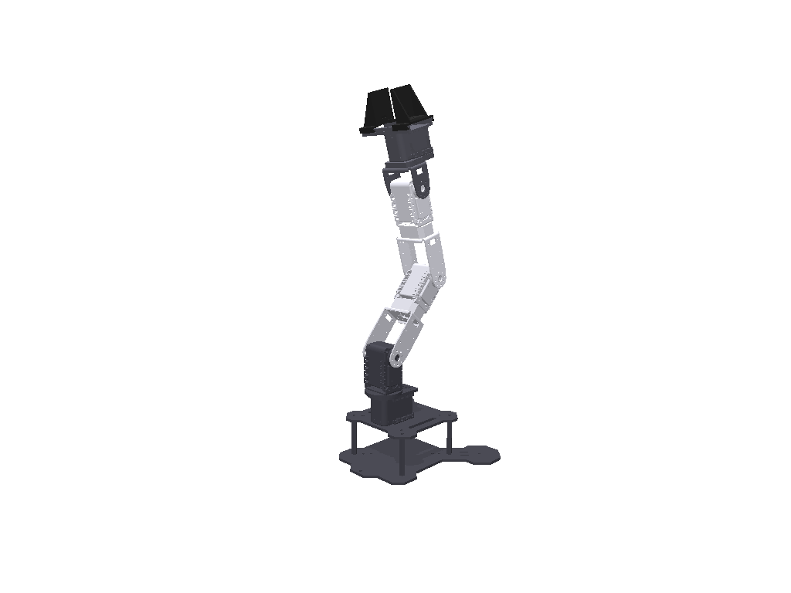

# SpatialReach — 单目空间认知机械臂

> 项目代号 **Touch**。一台 PhantomX Pincher 机械臂 + 一个单目摄像头。
> 目标不是「看见一个像素框」，而是让开发板在空间里知道：**我在哪、臂在哪、物体在哪、它们是什么关系**。

当前阶段：**仿真优先**。先把「单目 → 空间概念 → 抓取」的链路在仿真里完整跑通，再用同一套接口切真机。

> 论文库与技术路线：[docs/papers.md](docs/papers.md)（按推进阶段索引，含链接、优点与局限）。

---

## 1. 核心想法：单目摄像头如何建立空间概念

单张图像没有深度，也没有尺度。我们不靠深度网络去「猜」，而是**把机械臂本身当成一把已知的尺子**：

```
关节角（编码器/真值） + URDF
        ↓ FK
关节在基座系下的 3D 坐标  ←── 已知尺度
        ↓ 与图像中的 2D keypoints 对应
        PnP
        ↓
T_base←camera（相机相对基座的 6DoF 位姿）
        ↓
图像上任意像素 → 基座系下的一条射线
        ↓ 与桌面平面求交
物体在基座系下的 3D 位置
```

这条链成立后，单目图像第一次有了**度量**，并且这个坐标系锚定在机械臂上。相机随手放，只要画面里能看到臂，开发板就能重新把自己「放进」空间里——这就是「免现场标定」的来源。

### 空间概念的可验证定义

不做口号，只回答五个可量化的问题：

| # | 问题 | 输出 | 依赖 |
|---|---|---|---|
| 1 | 相机在哪 | `T_base←camera`（6DoF） | keypoints + PnP |
| 2 | 臂在哪 | 关节角 / 末端位姿 | keypoints + URDF |
| 3 | 物体在哪 | 基座系下的 3D 位置 | 检测 + 相机位姿 + 桌面平面 |
| 4 | 什么关系 | 左/右、前/后、远/近、可抓/不可抓 | 基座系坐标 |
| 5 | 动过之后 | 重锚定后的同一套表示 | 空间记忆与跟踪 |

### 为什么不是「跑个深度估计」

- 单目深度模型的绝对尺度不稳定，误差随场景漂移；
- 机械臂几何是**已知且精确**的，用它定尺度比网络可靠；
- 桌面平面是天然约束：物体本来就在桌上，射线求交即可得到 3D 位置；
- 深度模型可以作为可选先验（估计物体高度），但不作为主链路的尺度来源。

## 2. 为什么把重心放在仿真

1. **真值齐全**：相机位姿、关节角、物体 6D 位姿、深度、分割掩码，真机很难同时拿到。
2. **误差可分解**：keypoint 噪声 / 相机位姿误差 / 物体定位误差可以逐项注入，而不是只看到一个成功率。
3. **验证核心卖点**：相机可以任意摆、批量随机，「换个位置也能用」这件事只有仿真能大规模验证。
4. **不被硬件阻塞**：臂和板子未完全就位时，算法、数据、评测管线可以先行。
5. **同一接口切真机**：`ArmBackend` / `CameraSource` 两个协议把仿真与真机隔开，上层代码不感知后端。

## 3. 系统架构

```
┌──────────────────────────────────────────────────────────┐
│ 【已实现】仿真后端  PyBullet + TinyRenderer               │
│   sim/camera · sim/renderer · data/dataset                │
└───────────────────────────┬──────────────────────────────┘
                            │ ArmBackend / CameraSource
                            ▼
┌──────────────────────────────────────────────────────────┐
│ 【已实现】Learning / Perception                            │
│   learning/keypoint_model · perception/geometry · pose    │
│   图像 → heatmap → 2D 关键点 → PnP → 相机相对基座位姿     │
└───────────────────────────┬──────────────────────────────┘
                            ▼
┌──────────────────────────────────────────────────────────┐
│ 【未实现】Spatial（核心）  frames · scene_graph · relations │
│           基座系下的物体、关系、记住并更新                 │
└───────────────────────────┬──────────────────────────────┘
                            ▼
┌──────────────────────────────────────────────────────────┐
│ 【未实现】Grasp  kinematics · planner · executor          │
│           IK → 接近 → 抓取 → 放置                         │
└───────────────────────────┬──────────────────────────────┘
                            ▼
                    actions → ArmBackend
```

## 4. 目录结构

```
touch/
├── README.md
├── .gitignore
├── requirements.txt
├── configs/
│   ├── camera_acepro.yaml    # Ace Pro UVC 实测参数
│   └── camera_intrinsics.yaml# 1280×720 标定结果（K / dist，被 touch/camera.py 读取）
├── assets/
│   ├── robots/phantomx_pincher_cad/  # CAD URDF + 零件 STL（来源/许可见目录内 README）
│   ├── objects/              # 目标物体模型
│   ├── textures/             # 域随机化纹理
│   └── backgrounds/          # 域随机化背景
├── touch/                    # 只保留已实现模块（2026-10-25 已移除 11 个 1 行占位）
│   ├── __init__.py
│   ├── camera.py             # 真实相机：内参加载、去畸变、16:9→4:3 裁剪
│   ├── interfaces.py         # ArmBackend / CameraSource：仿真与真机的接缝
│   ├── data/
│   │   └── dataset.py        # M0Dataset + heatmap 标签
│   ├── learning/
│   │   ├── evaluate.py       # PCK / 位姿误差
│   │   └── keypoint_model.py # ResNet-18 + U-Net heatmap 网络
│   ├── perception/
│   │   ├── geometry.py       # 投影、反投影、射线-平面求交
│   │   └── pose.py           # PnP：相机相对基座的位姿
│   └── sim/
│       ├── camera.py         # 虚拟相机：FOV→K、投影、投影矩阵
│       └── renderer.py       # PyBullet TinyRenderer 离屏渲染
├── scripts/                  # 可执行入口：数据生成 / 训练 / 评测 / 渲染
│   └── ablation_report.py    # 统一评测：val 目录 + 预测 JSON → 一行完整指标
├── tests/
├── docs/
│   ├── papers.md             # 论文库：按推进阶段索引（链接 / 优点 / 局限）
│   ├── synthetic-data.md
│   ├── assets/
│   └── learning/             # 学习笔记镜像（主副本在 Obsidian，不入库）
├── data/                     # 数据（不入库）
│   ├── synthetic/
│   └── real/
└── outputs/                  # 渲染、日志、权重（不入库）
    ├── renders/
    ├── checkpoints/
    ├── eval/
    ├── runs/
    └── _archive/             # 2026-10-25 归档的一次性脚本与日志
```

## 5. 里程碑（仿真优先）

| 阶段 | 内容 | 交付物 | 退出条件（初始目标，M0 后校准） |
|---|---|---|---|
| **M0 场景与渲染** | PyBullet 场景、5 轴臂模型、可任意摆放的虚拟相机、TinyRenderer 离屏渲染 | 一条命令渲染出 RGB + 深度 + 分割 + 2D keypoints + 相机/关节真值 | 连续 100 帧无泄漏；标注叠加图与渲染图对齐 |
| **M1 单目自标定** | 关节角 + URDF → 3D keypoints；图像 → 2D keypoints；PnP 求 `T_base←camera` | 自标定模块 + 误差评测 | 仿真中平移误差 ≤1cm、旋转 ≤2° `待实测` |
| **M2 空间认知** | scene graph、物体 3D 定位（射线-平面求交）、关系判定、空间记忆与重锚定 | 空间查询 demo：`红色方块在机械臂左边多少厘米` | 物体 3D 误差 ≤1.5cm；关系查询准确率 ≥95%；挪相机后自动恢复 |
| **M3 闭环抓取** | 检测 → 空间定位 → IK → 抓取 → 放置 | 仿真闭环抓取 demo | 简单方块抓取成功率 ≥90%（20 次统计） |
| **M4 随机化与 sim2real** | 材质/光照/背景/相机随机化；实拍小样本评测；X5 导出与量化 | 量化报告 + 域随机化数据管线 | 实拍 PCK 达标（阈值待 M1/M2 实测后定） |

M0–M3 全程 PC，零真机依赖；M4 才引入实拍与开发板。

## 6. 技术栈

- **仿真**：PyBullet（物理 + TinyRenderer 离屏渲染）、trimesh（网格）
- **视觉**：PyTorch（keypoint heatmap / 检测）、OpenCV（PnP、标定、几何）
- **数值**：NumPy / SciPy
- **部署（后续）**：RDK X5 + TROS + Horizon `hb_mapper`（INT8/BPU）
- **Python**：3.11–3.13（若 pybullet 轮子不兼容，退 3.11）

## 7. 开发环境

PyBullet 在 Windows 上没有 pip 轮子，建议用 conda（Python 3.11）：

```bash
conda create -n arm_sim python=3.11
conda activate arm_sim
conda install -c conda-forge pybullet
pip install -r requirements.txt

# CUDA 12.8 PyTorch（RTX 5070 / sm_120）
pip install torch torchvision --index-url https://download.pytorch.org/whl/cu128
```

Linux/WSL 下 PyBullet 有 manylinux 轮子，可直接 `pip install -r requirements.txt`。

> 请先 `conda activate arm_sim` 再运行脚本。直接调用 `...\arm_sim\python.exe` 可能因 DLL 搜索路径冲突导致 numpy 崩溃。

渲染 URDF：

```bash
python scripts/render_urdf.py
# 输出到 outputs/renders/
```

> 渲染与臂控留在 Windows；训练可先在 Windows 原生；X5 量化工具链需要 Linux/WSL2。

### 机械臂模型

`assets/robots/phantomx_pincher_cad/` 是当前默认模型：由 PhantomX Pincher Mark II STEP 装配生成的 CAD URDF，包含底座 + 全臂网格，7 个关节，运动学来自 CAD 装配。

尺寸（2026-10-20 确认以 CAD 为准）：

- 基座 → 肩 pan：**9.44cm**
- 肩 lift → 肘：**10.70cm**
- 肘 → 腕：**10.70cm**



当前配置：CAD URDF 路径由 [generate_frames.py](file:///D:/documents/Code/touch/scripts/generate_frames.py#L35) 的 `URDF` 常量指定，指向 [phantomx_pincher_cad_keypoints.urdf](file:///D:/documents/Code/touch/assets/robots/phantomx_pincher_cad/phantomx_pincher_cad_keypoints.urdf)；基础模型由 [build_cad_urdf.py](file:///D:/documents/Code/touch/scripts/build_cad_urdf.py) 生成、关键点标记由 [build_keypoint_urdf.py](file:///D:/documents/Code/touch/scripts/build_keypoint_urdf.py) 注入，渲染见 [pincher_cad_views.png](file:///D:/documents/Code/touch/outputs/renders/pincher_cad_views.png)。

旧的手工 URDF 仅本地保留作对照；它的 5.4cm 基座高度是另一个参考点，不再作为默认。

### 真实相机（Ace Pro）

- `configs/camera_acepro.yaml`：UVC `1280×720@30` MJPG，`undistort: true`
- `configs/camera_intrinsics.yaml`：1280×720 标定结果，RMS `0.249px`
- `touch/camera.py`：`load_intrinsics` / `AceProCamera` / `prepare_model_input`
- 真实 16:9 画面先中心裁成 4:3，再送 640×480 keypoint 模型；K 会同步修正
  （`fx=419.645, fy=415.061, cx=321.297, cy=240.738`）
- 裁切后垂直 FOV 约 60°，与仿真虚拟相机一致
- 标定/真实相机脚本需要 OpenCV 环境：本机用 `conda activate cv_env`
- Demo：`scripts/demo_board_pose.py`（棋盘格位姿）/ `scripts/demo_color_pose.py`（颜色块 3D）

### 复现

```bash
# 1) 生成 9 点合成数据（单进程示例；大数据可用 parts + merge_parts.py）
python scripts/generate_frames.py --frames 1000 --seed 500 \
  --out data/synthetic/m0_kp9/train --yaw-min 0 --yaw-max 360 \
  --dist-min 0.35 --dist-max 0.60 --pitch-min -25 --pitch-max -5 --no-depth
python scripts/generate_frames.py --frames 100 --seed 501 \
  --out data/synthetic/m0_kp9/val --yaw-min 0 --yaw-max 360 \
  --dist-min 0.35 --dist-max 0.60 --pitch-min -25 --pitch-max -5 --no-depth

# 2) 训练（GPU，cache + AMP）
python scripts/train_keypoints.py --model resnet18 \
  --train-root data/synthetic/m0_kp9/train --val-root data/synthetic/m0_kp9/val \
  --steps 1000 --batch-size 64 --workers 0 --cache --lr 3e-3 \
  --stride 4 --sigma 3.0 --eval-every 500 \
  --ckpt outputs/checkpoints/m0_kp9_resnet18.pth

# 3) TensorBoard
tensorboard --logdir outputs/tb

# 4) 测试
pytest -q
```

## 8. 当前状态

- [x] 目录骨架与接口契约
- [x] PhantomX Pincher URDF（PyBullet 加载 + FK 验证通过）
- [x] 导师模式规则、skill 与学习文档
- [x] M0 相机内参与投影链路（5 tests passed，已接入渲染标注）
- [x] Ace Pro 内参标定 + 真实相机源（1280×720，RMS 0.249px；`touch/camera.py`，4 tests passed）
- [x] 真实 CAD 装配转换 + CAD 模型驱动 URDF（底座 + 全臂；零位与 CAD 误差 0；7 joints）
- [x] M0 合成数据：10 帧 RGB / depth / seg / 2D keypoints（`data/synthetic/m0/`）
- [x] M0 数据加载与 heatmap 标签（7 tests passed）
- [x] M0 最小过拟合训练（10 帧，mean 2.02px）
- [x] M0 数据扩增 + 逐帧随机化（600 train / 100 val）
- [x] M0 ResNet-18 基线（验证集平均像素误差 3.91px，软最大值解码 3.71px）
- [x] M0 热图步长 2 ResNet-18（验证集软最大值解码 4.22px，PCK@3 57.5%）
- [x] CAD 模型重训（验证集软最大值解码 5.30px，PCK@3 55.2%）
- [x] M1 PnP 对照：真值 6 点通过；预测 6 点 13.9cm / 16.1°
- [x] 模型对比：Tiny U-Net / ResNet-18 / MobileNetV3；ResNet-18 最好
- [x] 夹爪 keypoint 对照：去掉后 3.97px，但 5 点 PnP 仍不稳
- [x] 新 keypoint 彩色标记（K0–K5）：val 3.56px/60.2%；预测 PnP 7.14cm/10.23°
- [x] 9 点外抱环标记（D 组）+ gamma 预处理：test 500 帧 2D median 2.03px / PCK@3 81.4% / 平移 median 2.00cm / p95 7.58cm / 翻转 14 帧
- [x] PnP 误差分解（6 点 100 帧）：误差是**双峰**——`rot<5°` 的 46/100 帧平移 p50 仅 1.96cm；翻转与 `|pan|` 无关（corr 0.18）；`gt_5`（完美 2D 只少 1 点）仍翻转 1/100
- [x] 工作区减法：移除 11 个 1 行占位模块与 2 个未被引用的 config；一次性脚本/日志归档至 `outputs/_archive/`；评测入口上移为 `scripts/ablation_report.py`
- [x] **P0 求解器**：`solve_pnp` 默认改 SQPNP；新增 `solve_pnp_candidates`（IPPE+SQPNP 多候选）与 `select_candidate`（物理先验）。翻转 14→9/500，但 14 个翻转帧里只有 6 帧的正确解在候选集中 → 选解不是瓶颈，几何才是
- [x] **P0 指标**：一级指标改为 `flip_rate` + `usable@容差`，`scripts/ablation_report.py` 已输出
- [x] **P0 误差预算**：[docs/error-budget.md](docs/error-budget.md)。关键结论：**旋转误差才是瓶颈**——0.4m 处 5° 会放大成 3.5cm
- [x] **P0 凸耳设计**：δ 扇扫定出 **≥3cm、推荐 5cm**（可用率 71.6%→80.0%）；`build_keypoint_urdf.py --lug-cm 5` 生成带凸耳 URDF。**δ≤1cm 反而更差**
- [ ] **P0 待决策**：两个凸耳都被遮挡时（歧义 7/200 且与 δ 无关），兜底用多帧一致性还是拒答挪相机
- [ ] M1：用凸耳 URDF 重生成数据 + 重训（会作废当前 checkpoint）
- [ ] M1：真机 10–20 帧 + ArUco 真值最小验证
- [ ] M2：空间认知层
- [ ] M3：闭环抓取
- [ ] M4：域随机化 / sim2real / X5

> 论文与技术路线见 [docs/papers.md](docs/papers.md)；阶段索引与该走哪一步见其 §0。

## 9. 边界说明

- **「免标定」免的是外参/现场标定**，相机内参仍需一次性标定（定焦镜头标一次长期有效）。
- Pincher 本体是 4 个旋转关节 + 1 个夹爪自由度，末端姿态能力有限，不做任意姿态的精细操作；聚焦桌面俯视抓取与分拣。
- 单目尺度来自**机械臂已知几何 + 桌面平面**，不依赖单目深度网络的绝对尺度。
- 仿真结论不等于真机结论：臂本体精度、sim2real gap、BPU 实测必须在真机上复核。
